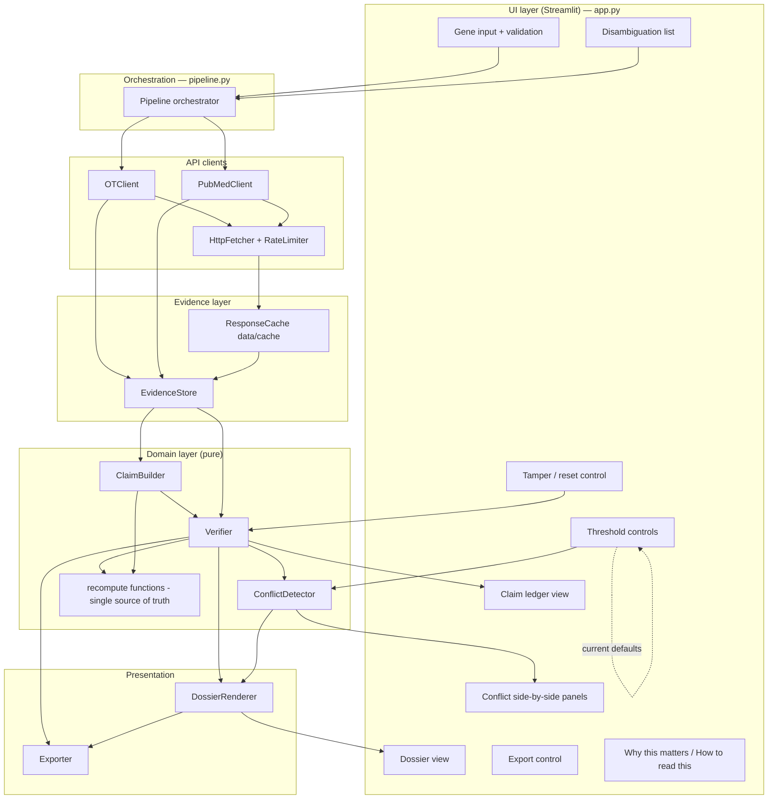
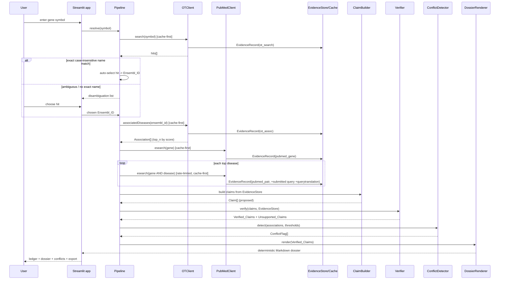
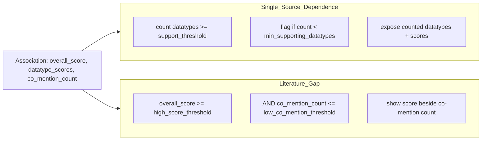

# Design Document

## Overview

Claim Ledger is a Streamlit web application (Python 3.10+) that turns a human gene symbol into an auditable, evidence-backed dossier of reported disease associations. The design is organized around one invariant that overrides every convenience: **no number reaches the screen unless it has been recomputed from a cached, real API response and matched exactly.** Every architectural decision below exists to make that invariant hold and to make it testable.

The pipeline is strictly layered so that evidence, claims, verification, and prose are separable concerns:

1. The **UI layer** (Streamlit) collects a gene symbol, handles disambiguation, renders the ledger and dossier, exposes threshold controls, and offers tamper/reset and export.
2. The **orchestration/pipeline layer** sequences resolution → retrieval → claim building → verification → conflict detection → rendering, holding the per-run `EvidenceStore`.
3. The **API client layer** (`OTClient`, `PubMedClient`) issues GraphQL and E-utilities requests behind a cache-first policy, rate limiting, and timeouts.
4. The **evidence layer** (`EvidenceStore` + `ResponseCache`) persists every raw response to `data/cache` and mints stable `Evidence_ID`s.
5. The **domain layer** (`ClaimBuilder`, `Verifier`, `ConflictDetector`) holds the pure recompute logic that is the single source of truth for every number.
6. The **presentation layer** (`DossierRenderer`, `Exporter`) deterministically renders Markdown prose from verified claims only and exports JSON + Markdown.

No language model runs at runtime. Rendering is template-based and deterministic (Requirements 8.4, 10; steering rules 4, 5, 10).

This design is subordinate to `.kiro/steering/evidence-rules.md`. All ten rules are treated as binding; where a design choice implements a rule it is annotated (for example, "steering rule 8" for parsing against saved real responses).

### Grounding in real cached responses (steering rule 8)

All parsing shapes below were read from the committed preflight responses, not assumed:

- `data/cache/preflight_ot_search.json` — a cache envelope `{source_url, retrieved_at, payload}` where `payload.data.search.hits[]` each carry `{id, name, entity}`. The EGFR example has a single hit `{id: "ENSG00000146648", name: "EGFR", entity: "target"}`.
- `data/cache/preflight_ot_associations.json` — `payload.data.target.{id, approvedSymbol, approvedName, associatedDiseases.{count, rows[]}}`. Observed: `count` is an **integer** (5860); each row has `{score (float), datatypeScores[].{id, score}, disease.{id, name}}`. **Datatype arrays vary per row**: the first row ("non-small cell lung carcinoma") has 6 datatype scores; the "cancer" row has only 3. Order is not stable. Parsing therefore keys on `datatypeScores[].id`, never on position.
- `data/cache/preflight_pubmed_gene.json` and `preflight_pubmed_gene_and_disease.json` — `payload.esearchresult.{count, retmax, retstart, idlist[], querytranslation, translationset[]}`. Observed: `count`, `retmax`, `retstart` are **strings** ("108097", "3", "0"); `idlist` is a list of PMID strings; `querytranslation` records PubMed's interpretation. In the gene+disease example PubMed rewrote the disease clause to a MeSH term, so `querytranslation` can differ materially from the submitted term — this is why the submitted query string and `querytranslation` are both stored (Requirement 4.3).

A critical shape consequence: **OT association `count` is an int, PubMed `count` is a string.** The OT overall/datatype scores are floats; the PubMed counts require `str → int` conversion. The verifier's tolerance rules (float tolerance vs. exact integer equality, Requirement 6.5/6.6) map directly onto this split.

The cache envelope stores the key as `source_url` and the timestamp as `retrieved_at` at the top level. The evidence layer maps the envelope `source_url` to `Evidence_Record.url` and envelope `retrieved_at` to `Evidence_Record.retrieved_at`, and treats envelope `payload` as `Evidence_Record.payload` (Requirements 4.1, 11.7).

## Architecture

### Component diagram



### End-to-end data flow (gene symbol → rendered dossier)



The pipeline never lets an unverified claim into the dossier: `DossierRenderer` is only ever handed `Verified_Claims` (Requirement 8.1, steering rule 4). Conflict detection runs on parsed associations and re-runs whenever a threshold changes (Requirement 9.7).

## Project Structure

Concrete layout under `src/` and `tests/`. The package is `claimledger`.

```
src/claimledger/
  __init__.py
  config.py          # Config/Thresholds dataclasses, defaults, Example_Gene registry   (Req 9.6, 11.1-11.3)
  models.py          # EvidenceRecord, Claim, ClaimType, DatatypeScore, Association,
                     #   ConflictFlag, ClaimStatus, VerificationResult                   (Req 4,5,6,9)
  cache.py           # ResponseCache: request-key -> cache file, read/write envelope      (Req 4.4, 11.5-11.7)
  http.py            # HttpFetcher + RateLimiter (<=3 req/s), timeouts, cache-first glue   (Req 3.9, 11.5-11.6)
  evidence.py        # EvidenceStore: mint Evidence_ID, hold records, lookup              (Req 4.1-4.3, 4.5)
  clients/
    __init__.py
    opentargets.py   # OTClient: GraphQL search + associatedDiseases queries, parsing     (Req 1,2)
    pubmed.py        # PubMedClient: esearch URLs/params, parsing, rate limit             (Req 3)
  claims.py          # ClaimBuilder: build 5 claim types from evidence                    (Req 5)
  recompute.py       # recompute_<type>() pure functions: SINGLE SOURCE OF TRUTH          (Req 4.5, 6.1)
  verify.py          # Verifier: recompute-and-compare, tolerance, no-repair              (Req 6,7,13)
  conflicts.py       # ConflictDetector: Single_Source_Dependence, Literature_Gap         (Req 9)
  render.py          # DossierRenderer: deterministic Markdown from Verified_Claims        (Req 8,10)
  export.py          # Exporter: claims -> JSON, dossier -> Markdown                       (Req 14.5)
  pipeline.py        # Pipeline orchestrator wiring all layers                             (Req 1-11)
  app.py             # Streamlit entry point (UI only)                                     (Req 1,9,10,13,14)

tests/
  conftest.py              # fixtures: load committed cache envelopes, build EvidenceStore
  strategies.py            # Hypothesis strategies for Association/DatatypeScore/Claim/Evidence
  test_verifier.py         # Property: soundness/completeness, no-repair                   (Req 12.2, 6)
  test_render.py           # Property: determinism + provenance                            (Req 12.3, 8,7)
  test_conflicts.py        # Property: symmetry/order-independence                          (Req 12.4, 9)
  test_recompute.py        # Property: score recomputation fidelity                        (Req 12.5, 2,6)
  test_roundtrip.py        # Property: parse -> serialize -> parse                          (Req 12.6)
  test_tamper.py           # Property: tamper-reject / reset-accept                         (Req 12.7, 13)
  test_clients.py          # Example-based: parse the committed cached responses            (Req 12.8, 1,2,3)
  test_offline.py          # Example-based: Example_Genes resolve/render offline            (Req 11)
  fixtures/cache/          # committed cached responses for EGFR, TP53, BRCA1, + 4th gene   (Req 11.2)
```

Module-to-requirement mapping is repeated in the Requirements Traceability section at the end.

## Components and Interfaces

### Config and thresholds (`config.py`)

Holds the configurable thresholds with their defaults and the Example_Gene registry. Thresholds are a frozen dataclass so a change produces a new object the `ConflictDetector` re-evaluates against (Requirement 9.7).

```python
@dataclass(frozen=True)
class Thresholds:
    top_n: int = 5                     # Req 2.7
    retmax: int = 3                    # Req 3.6
    support_threshold: float = 0.3     # Req 9.2, 9.6
    min_supporting_datatypes: int = 2  # Req 9.2, 9.6
    high_score_threshold: float = 0.5  # Req 9.3, 9.6
    low_co_mention_threshold: int = 100# Req 9.3, 9.6

@dataclass(frozen=True)
class Config:
    thresholds: Thresholds = Thresholds()
    tool: str = "claimledger"          # Req 3.10
    email: str = "hackathon@example.com"  # Req 3.10
    ot_graphql_url: str = "https://api.platform.opentargets.org/api/v4/graphql"
    pubmed_esearch_url: str = "https://eutils.ncbi.nlm.nih.gov/entrez/eutils/esearch.fcgi"
    http_timeout_s: float = 10.0
    max_requests_per_second: float = 3.0  # Req 3.9
```

### API clients (`clients/opentargets.py`, `clients/pubmed.py`)

Both clients share `HttpFetcher` (cache-first fetch + rate limiting + timeout) and write every response into `EvidenceStore` via `ResponseCache`. Clients expose pure parse functions that operate on an already-fetched payload so the parsing can be unit-tested directly against the committed cache (steering rule 8, Requirement 4.6, 12.8).

`OTClient`:
- `search(symbol) -> list[SearchHit]` — parses `payload.data.search.hits[]`.
- `resolve(symbol, hits) -> ResolveOutcome` — applies Requirement 1.3/1.5/1.6 selection logic.
- `associated_diseases(ensembl_id) -> TargetAssociations` — parses `payload.data.target.*`.

`PubMedClient`:
- `esearch_gene(symbol) -> PubMedResult`
- `esearch_pair(symbol, disease_name) -> PubMedResult` — term formatting per Requirement 3.4.

### Evidence store and cache (`evidence.py`, `cache.py`)

`EvidenceStore` is a per-run mapping `Evidence_ID -> EvidenceRecord` with `add(record)`, `get(evidence_id) -> EvidenceRecord | None`, and `contains(evidence_id) -> bool`. `ResponseCache` maps a request key to a cache file under `data/cache` and reads/writes the `{source_url, retrieved_at, payload}` envelope.

### Domain layer (`recompute.py`, `claims.py`, `verify.py`, `conflicts.py`)

`recompute.py` is the single source of truth. Both `ClaimBuilder` and `Verifier` call the same `recompute_*` functions so a builder/verifier divergence is impossible by construction (Requirement 4.5, 6.1; steering rule 3).

### Presentation (`render.py`, `export.py`)

`DossierRenderer.render(verified_claims) -> str` returns deterministic Markdown. `Exporter` serializes `Verified_Claims` and `Unsupported_Claims` to JSON and the dossier to Markdown (Requirement 14.5).

## Data Models

**Library choice: standard-library `dataclasses`, not Pydantic.** Justification: the domain logic (recompute, verify, conflict) must be pure and deterministic, and the models are internal — all external JSON is raw API payload that we parse by hand against saved shapes (steering rule 8), so Pydantic's coercion/validation would add a second, implicit parsing layer that could silently "repair" shapes and mask the mismatches the verifier exists to catch (steering rule 3, "never repair"). Frozen dataclasses give value semantics, cheap equality for round-trip tests, and `hash`-stability for deterministic ordering, with zero coercion. Serialization for export and round-trip tests is explicit (`to_dict`/`from_dict`).

```python
class Source(str, Enum):
    OT_SEARCH = "ot_search"
    OT_ASSOCIATIONS = "ot_associations"
    PUBMED_GENE = "pubmed_gene"
    PUBMED_PAIR = "pubmed_pair"

@dataclass(frozen=True)
class EvidenceRecord:
    evidence_id: str          # stable within run (see Evidence IDs section)   Req 4.1, 4.2
    source: Source            # which interface produced it
    url: str                  # request URL (envelope source_url when cached)  Req 4.1, 11.7
    retrieved_at: str         # ISO-8601 UTC string                            Req 4.1, 11.7
    payload: dict             # raw response body, parsed by hand              Req 4.1, 4.6
    submitted_query: str | None = None     # gene+disease PubMed only          Req 4.3
    query_translation: str | None = None   # esearchresult.querytranslation    Req 4.3
    from_cache: bool = False  # surfaced in UI as "came from cache"            Req 11.5

@dataclass(frozen=True)
class DatatypeScore:
    id: str                   # clinical | genetic_literature | affected_pathway
                              #  | literature | genetic_association | somatic_mutation
    score: float

@dataclass(frozen=True)
class Association:
    disease_id: str
    disease_name: str
    overall_score: float                 # Req 2.4
    datatype_scores: tuple[DatatypeScore, ...]  # tuple: immutable + order captured but not relied on
    evidence_id: str                     # the ot_associations record
    incomplete: bool = False             # Req 2.6 (a required field was missing)

class ClaimType(str, Enum):
    ASSOCIATION = "ASSOCIATION"              # value: float (Overall_Score)
    DATATYPE_BREAKDOWN = "DATATYPE_BREAKDOWN"# value: tuple[DatatypeScore, ...]
    LITERATURE_COUNT = "LITERATURE_COUNT"    # value: int
    CO_MENTION_COUNT = "CO_MENTION_COUNT"    # value: int
    RECENT_PAPER = "RECENT_PAPER"            # value: str (PMID)

class ClaimStatus(str, Enum):
    VERIFIED = "Verified"
    UNSUPPORTED = "Unsupported"

@dataclass(frozen=True)
class Claim:
    claim_id: str
    claim_type: ClaimType
    subject: str                # gene symbol or "GENE::DISEASE" key for context
    value: object               # float | tuple[DatatypeScore,...] | int | str per type
    evidence_ids: tuple[str, ...]        # >= 1 (Req 5.2, steering rule 1)
    status: ClaimStatus = ClaimStatus.VERIFIED
    reason: str | None = None            # populated when UNSUPPORTED (Req 7.1)
    original_value: object = None        # set by Tamper_Control for reset (Req 13.3)

@dataclass(frozen=True)
class ConflictFlag:
    rule: str                   # "Single_Source_Dependence" | "Literature_Gap"
    disease_id: str
    disease_name: str
    # Single_Source_Dependence detail:
    supporting_datatypes: tuple[DatatypeScore, ...] = ()  # those >= support_threshold (Req 9.5)
    supporting_count: int = 0
    # Literature_Gap detail:
    overall_score: float | None = None
    co_mention_count: int | None = None
    thresholds: Thresholds | None = None   # the thresholds in force when flagged
```

### Value type per claim type (Requirement 5.1, 5.3–5.7)

| Claim type | `value` type | Recompute source |
|---|---|---|
| `ASSOCIATION` | `float` | `payload.data.target.associatedDiseases.rows[i].score` |
| `DATATYPE_BREAKDOWN` | `tuple[DatatypeScore, ...]` | `rows[i].datatypeScores[]` (by content) |
| `LITERATURE_COUNT` | `int` | `int(payload.esearchresult.count)` from gene-only record |
| `CO_MENTION_COUNT` | `int` | `int(payload.esearchresult.count)` from gene+disease record |
| `RECENT_PAPER` | `str` (PMID) | one element of `payload.esearchresult.idlist` |

## Evidence IDs and Determinism

### Stable Evidence_IDs (Requirement 4.2, cache/live parity)

An `Evidence_ID` is a deterministic function of the logical request, not of wall-clock time or object identity, so a cached fetch and a live fetch of the same request map to the **same** id:

```
evidence_id = source.value + ":" + sha256(normalized_request_key)[:16]
```

The `normalized_request_key` is built per source from stable inputs:
- `OT_SEARCH`: `graphql + "|search|" + symbol.strip().upper()`
- `OT_ASSOCIATIONS`: `graphql + "|assoc|" + ensembl_id + "|top_n=" + top_n`
- `PUBMED_GENE`: the canonicalized esearch URL with query params sorted (gene term, retmax, retmode, db)
- `PUBMED_PAIR`: the canonicalized esearch URL for the gene+disease term

Because the key is normalized (trimmed, upper-cased symbol; sorted query params; `tool`/`email` excluded from the hash since they do not change which evidence is returned), the same logical request yields the same id whether served live or from cache. This makes the cache-fallback transparent to claims and verification (Requirement 11.5, 11.7).

### Deterministic ordering (Requirement 8.2, 8.3)

Rendering never depends on dict insertion order, set iteration, or retrieval order. The renderer sorts `Verified_Claims` by an explicit composite key:

```
sort_key = (disease_rank, claim_type_rank, disease_id, claim_id)
```

where `disease_rank` is the association's rank by descending `overall_score` with `disease_id` as a tie-breaker, and `claim_type_rank` is a fixed ordinal over the five claim types. `datatype_scores` are sorted by `datatype.id` before rendering. Any place that iterates a mapping sorts its keys first. This yields byte-identical output for the same `Verified_Claims` under any input permutation (Requirement 8.2, Correctness Property "Rendering determinism").

## API Clients

### Open Targets GraphQL (`clients/opentargets.py`)

Endpoint: `https://api.platform.opentargets.org/api/v4/graphql` (Requirement 1.2). POST with JSON `{query, variables}`.

Search query (resolution, Requirement 1.2–1.3):

```graphql
query Search($q: String!) {
  search(queryString: $q, entityNames: ["target"]) {
    hits { id name entity }
  }
}
```

Parsed from `payload.data.search.hits[]` → `{id, name, entity}`. Resolution logic:
- 1.3: pick the hit with `entity == "target"` whose `name` equals the submitted symbol case-insensitively → `Ensembl_ID = id`, resolved symbol = `name`.
- 1.5: no `entity == "target"` hit → "could not be resolved", stop.
- 1.6: target hits exist but none name-match → show disambiguation, do not auto-select.
- 1.7: user choice → use chosen `id`/`name`.

Associations query (Requirement 2.1–2.5):

```graphql
query Assoc($ensemblId: String!, $size: Int!) {
  target(ensemblId: $ensemblId) {
    id
    approvedSymbol
    approvedName
    associatedDiseases(page: { index: 0, size: $size }) {
      count
      rows {
        score
        datatypeScores { id score }
        disease { id name }
      }
    }
  }
}
```

Parsing (grounded in `preflight_ot_associations.json`):
- `data.target.{id, approvedSymbol, approvedName}` (Requirement 2.2).
- `data.target.associatedDiseases.count` is an **int** (Requirement 2.3).
- Each `rows[]`: `score` (float Overall_Score), `disease.{id,name}`, and `datatypeScores[]` parsed **by element content** keyed on `id`, never by index (Requirement 2.4, 2.5) — the cache shows 6 datatypes in one row and 3 in another with differing order.
- Missing expected field in a row → mark `Association.incomplete = True` and continue (Requirement 2.6).
- Select top `top_n` (default 5) by descending `score` with `disease_id` tie-break (Requirement 2.7).

### PubMed E-utilities (`clients/pubmed.py`)

Endpoint: `https://eutils.ncbi.nlm.nih.gov/entrez/eutils/esearch.fcgi`. GET with params (grounded in the two preflight PubMed envelopes):

```
db=pubmed
retmode=json
retmax=<thresholds.retmax, default 3>     # Req 3.6
term=<formatted term>
tool=claimledger                           # Req 3.10
email=hackathon@example.com                # Req 3.10
```

Term formatting (Requirement 3.4): gene-only `"GENE"[Title/Abstract]`; gene+disease `"GENE"[Title/Abstract] AND "DISEASE NAME"[Title/Abstract]` — each clause double-quoted, each tagged `[Title/Abstract]`, joined by `AND`. The submitted term is stored verbatim; PubMed may rewrite it (the cached pair response shows PubMed mapping the disease to a `[MeSH Terms]` translation), so `esearchresult.querytranslation` is stored alongside (Requirement 3.5, 4.3).

Parsing:
- `esearchresult.count` is a **string**; convert to a non-negative int (Requirement 3.2). If absent or unparseable, record the count as **unavailable** and continue (Requirement 3.8) — never fabricate a number (steering rule 3).
- `esearchresult.idlist` → ordered PMIDs; `retmax`, `retstart` parsed (strings) (Requirement 3.3). Recent papers use `idlist` order (Requirement 3.7).

### Rate limiting, timeouts (Requirement 3.9)

`RateLimiter` enforces ≤ 3 requests/second to PubMed using a monotonic-clock token/leaky-bucket (min inter-request spacing of 1/3 s), applied before each outbound PubMed call. All HTTP calls use `http_timeout_s` (default 10 s).

### Cache-first / cache-fallback (Requirement 11.4–11.7, 4.4)

`HttpFetcher.fetch(request_key, url, do_request)`:
1. Compute the cache file path from `request_key` (same normalization as the Evidence_ID key).
2. **Cache-first for Example_Genes / offline:** if a cache file exists and external access is unavailable (or offline mode), load the envelope, build an `EvidenceRecord` with `from_cache=True` using the envelope's original `source_url`→`url` and `retrieved_at` (Requirement 11.7), and return it.
3. Otherwise attempt the live request with timeout and rate limiting; on success, write the `{source_url, retrieved_at, payload}` envelope to `data/cache` (Requirement 4.4) and build an `EvidenceRecord` (`from_cache=False`).
4. **Fallback:** if the live request fails/times out and a cache file exists, use the cached envelope and set `from_cache=True`; the UI surfaces "came from cache" (Requirement 11.5).
5. If it fails/times out and no cache exists, surface "interface unavailable" and continue with evidence already gathered (Requirement 11.6).

Because the Evidence_ID is derived from the same normalized key, a cache hit and a live fetch produce the same id, so claims reference evidence identically in both modes.

## Claim Building

`ClaimBuilder` constructs the five claim types from `EvidenceStore` records, attaching ≥ 1 `Evidence_ID` to every claim (Requirement 5.2, steering rule 1). Every value is produced by calling the corresponding `recompute_*` function in `recompute.py`, so the builder and verifier can never disagree:

- `ASSOCIATION` (per gene-disease pair): `value = recompute_association(record, disease_id)` = `rows[i].score`; `evidence_ids = (ot_assoc_id,)` (Requirement 5.3).
- `DATATYPE_BREAKDOWN`: `value = recompute_datatype_breakdown(record, disease_id)` = ordered-by-id tuple of `DatatypeScore` (Requirement 5.4).
- `LITERATURE_COUNT` (gene): `value = recompute_literature_count(gene_record)` = `int(count)`; references the gene-only PubMed record (Requirement 5.5).
- `CO_MENTION_COUNT` (pair): `value = recompute_co_mention_count(pair_record)` = `int(count)`; references the gene+disease record (Requirement 5.6).
- `RECENT_PAPER`: `value = idlist[k]` (a single PMID) from a PubMed record; references that record (Requirement 5.7).

Any model-proposed claims are accepted only as structured `Claim` data and never as final prose (Requirement 5.8, steering rule 5). If a required field is unavailable (e.g., PubMed count unavailable), the builder either omits that claim or emits it so the verifier rejects it with a reason — it is never silently kept (steering rule 6).

## Verifier

`Verifier.verify(claim, store) -> VerificationResult` is pure, side-effect-free, and **never mutates, repairs, or substitutes** the claim value (Requirement 6.7, steering rule 3). Algorithm:

1. **Evidence-existence check (Requirement 6.2):** for each `evidence_id` in `claim.evidence_ids`, if `not store.contains(evidence_id)` → reject with reason `"missing evidence: <evidence_id>"`.
2. **Recompute (Requirement 6.1):** call the `recompute_*` function for `claim.claim_type` on the referenced record(s) to produce `recomputed`.
3. **Compare:**
   - `ASSOCIATION`, `DATATYPE_BREAKDOWN`: numeric comparison with absolute tolerance `1e-9` (Requirement 6.5). For the breakdown, compare as sets keyed by datatype `id` with per-score tolerance, so ordering never affects the verdict.
   - `LITERATURE_COUNT`, `CO_MENTION_COUNT`, `RECENT_PAPER`: exact equality (Requirement 6.6).
4. **Verdict:** equal → `VERIFIED` (Requirement 6.4). Not equal → `UNSUPPORTED` with reason `"claim value <v> != recomputed <r>"` reporting both (Requirement 6.3).

Recompute function per claim type (shared with the builder):

```python
def recompute_association(rec, disease_id) -> float            # rows[i].score
def recompute_datatype_breakdown(rec, disease_id) -> tuple[DatatypeScore,...]  # by id
def recompute_literature_count(rec) -> int                     # int(esearchresult.count)
def recompute_co_mention_count(rec) -> int                     # int(esearchresult.count)
def recompute_recent_paper(rec, pmid) -> str                   # pmid if in idlist else sentinel
```

The result object carries `status`, `reason`, `claim_value`, and `recomputed_value` for display (Requirement 7.4) and for the tamper reason (Requirement 13.2).

## Conflict Detector

`ConflictDetector.detect(association, thresholds) -> list[ConflictFlag]` evaluates both named rules for each top association (Requirement 9.1) and re-evaluates on any threshold change (Requirement 9.7). Both rules are deliberately order-independent so the property tests in Requirement 12.4 hold.

### Single_Source_Dependence (Requirement 9.2, 9.5)

```
supporting = [d for d in association.datatype_scores if d.score >= thresholds.support_threshold]
supporting_count = len(supporting)
flag if supporting_count < thresholds.min_supporting_datatypes
```

The verdict depends only on *how many* datatypes reach `support_threshold`, not on their order — `supporting` is a filter over an unordered multiset of `(id, score)`. The flag exposes the counted datatypes with their scores (`supporting_datatypes`, `supporting_count`) so the UI can name each datatype that met the threshold (Requirement 9.5).

### Literature_Gap (Requirement 9.3)

```
flag if association.overall_score >= thresholds.high_score_threshold
   and co_mention_count <= thresholds.low_co_mention_threshold
```

Both operands are scalars; there is no ordering to depend on. If `co_mention_count` is unavailable the rule is not evaluated for that pair (no fabricated flag).

### Side-by-side presentation (Requirement 9.4, 9.8)

A flagged association is always shown with both sides of its evidence visible — the supporting datatype scores next to the overall score, and the overall score next to the co-mention count — never hiding one side (steering rule 7). Each flag is named in the UI as `Single_Source_Dependence` or `Literature_Gap`.



## Dossier Renderer

`DossierRenderer.render(verified_claims) -> str` produces Markdown from `Verified_Claims` only (Requirement 8.1, steering rule 4), with no language model (Requirement 8.4, steering rule 5). It is a pure function of its input.

- **Determinism (Requirement 8.2, 8.3):** claims are sorted by the fixed composite `sort_key` described in Evidence IDs and Determinism; no dict/set iteration order is used. Same `Verified_Claims` → byte-identical text under any permutation.
- **Approved wording (Requirement 10.1, 10.2; steering rule 9):** templates use only "associated with" and "reported in". A render-time guard asserts the output contains none of "causes", "proves", "validated", "promising" (and the gene→disease direction is never phrased as causation). Overall_Score is always labeled an "evidence-strength score", never a probability (Requirement 8.5, 10.5).
- **Provenance (Requirement 7.2):** `Unsupported_Claims` never contribute to prose. They are listed in a separate ledger section with type, referenced `Evidence_IDs`, and reason (Requirement 7.1, 7.4) — excluded from the dossier narrative but never silently dropped (steering rule 6).

Example prose shape (template, not generated): "EGFR is associated with non-small cell lung carcinoma (evidence-strength score 0.85, reported in 18,950 co-mentions)." No probability language, no recommendation (Requirement 10.3).

## Tamper / Reset Mechanism (Requirement 13)

The `Tamper_Control` operates purely on a `Claim`'s in-memory `value`; it never touches an `EvidenceRecord` or the on-disk cache (Requirement 13.4, steering rule 8).

1. **Tamper (Requirement 13.1, 13.2):** the UI selects one `Claim`, stores its current value into `original_value` (if not already set), and replaces `value` with an altered value. The pipeline re-runs `Verifier.verify` on just that claim. Because the altered value no longer equals the recompute from the untouched evidence, the verifier returns `UNSUPPORTED` with a reason reporting both the tampered value and the recomputed value. The UI shows the claim as Unsupported with that reason.
2. **Reset (Requirement 13.3):** the reset control restores `value = original_value`, clears the tamper state, and re-runs the verifier; the claim returns to `VERIFIED`.
3. **Immutability (Requirement 13.4):** only the `Claim.value` changes. `EvidenceStore` and `data/cache` are read-only to this control. This is exactly the invariant the tamper property test asserts (Requirement 12.7).

## UI Design (Streamlit)

Layout in `app.py`, UI-only (no parsing or recompute logic lives here):

- **Gene input screen (Requirement 1.1, 1.4):** text input; empty/whitespace submit shows a validation message and issues no OT request.
- **Disambiguation (Requirement 1.6, 1.7):** when no exact name match, render the target hits as a selectable list; the user's choice drives resolution. No auto-select of the first hit.
- **Results screen** (every results screen shows the mandatory items):
  - Persistent notice **"Evidence summary, not medical advice"** (Requirement 10.4).
  - **Verification note** clarifying that verification confirms a displayed number matches its saved source evidence, not that the finding is true (Requirement 10.6).
  - **Threshold controls** (Requirement 9.6) showing current values with defaults visible: `min_supporting_datatypes=2`, `support_threshold=0.3`, `high_score_threshold=0.5`, `low_co_mention_threshold=100`. Changing any re-runs the `ConflictDetector` (Requirement 9.7).
  - **Claim ledger:** each claim with status as **text** ("Verified"/"Unsupported"), never color alone (Requirement 14.3); Unsupported claims list type, evidence ids, and reason (Requirement 7.1, 7.4).
  - **Conflict panels (Requirement 9.4, 9.5, 9.8):** for each flagged association, a side-by-side panel naming `Single_Source_Dependence` / `Literature_Gap`, showing counted datatype scores on one side and overall score vs. co-mention count on the other.
  - **"Why this matters" panel (Requirement 14.1):** who benefits, plain-language explanation of the claim ledger, and the data sources Open Targets and PubMed.
  - **"How to read this" legend (Requirement 14.2):** explains Verified/Unsupported statuses and the two conflict flags.
  - **Provenance view (Requirement 4.7):** on request, show a claim's evidence `source`, `url`, `retrieved_at`, and for a co-mention count also the submitted query string and `Query_Translation`. A "came from cache" indicator where applicable (Requirement 11.5).
  - **Tamper/reset control (Requirement 13).**
  - **Download control (Requirement 14.5):** exports Verified + Unsupported claims as JSON and the dossier as Markdown.
- **Accessibility (Requirement 14.3, 14.4):** status always conveyed by text; sufficient contrast for status and body text.

## Error Handling

| Condition | Behavior | Requirement |
|---|---|---|
| Empty/whitespace gene symbol | Validation message, no OT request issued | 1.4 |
| No `entity == target` hit | "could not be resolved" message, stop the flow | 1.5 |
| Target hits but no name match | Show disambiguation list, user chooses | 1.6, 1.7 |
| Missing expected field in an OT association row | Mark `Association.incomplete`, continue other rows | 2.6 |
| PubMed `count` missing/unparseable | Record count unavailable, continue other queries | 3.8 |
| External request fails/times out, cache exists | Use cached response, indicate "came from cache" | 11.5 |
| External request fails/times out, no cache | "interface unavailable" message, continue with evidence already gathered | 11.6 |
| Example_Gene selected while offline | Complete whole pipeline from cache only | 11.4 |
| Verifier recompute mismatch | Claim shown Unsupported with reason (value vs recomputed); never repaired | 6.3, 6.7 |

No error path fabricates or repairs a number; missing data becomes an explicit "unavailable"/"incomplete"/"Unsupported" state (steering rules 3, 6).


## Correctness Properties

*A property is a characteristic or behavior that should hold true across all valid executions of a system — essentially, a formal statement about what the system should do. Properties serve as the bridge between human-readable specifications and machine-verifiable correctness guarantees.*

These properties are suited to property-based testing because the critical logic — the verifier, the recompute functions, the conflict rules, the renderer, and the serializer — are pure functions with large input spaces and universal invariants. Requirement 12 mandates pytest + Hypothesis. External-interface shapes (OT/PubMed parsing, rate limiting, offline resilience) are tested by representative cached examples instead, per Requirement 12.8.

### Property 1: Verifier soundness and completeness

*For any* Claim and any Evidence_Store, the Verifier accepts the Claim as Verified if and only if every referenced Evidence_ID is present in the store and the Claim value equals the value recomputed from the referenced Evidence_Record(s) — within an absolute tolerance of 1e-9 for Overall_Score and Datatype_Score values, and by exact equality for Literature_Count, Co_Mention_Count, and PMID values; and when it rejects, the reason reports both the Claim value and the recomputed value (or names the missing Evidence_ID).

**Validates: Requirements 6.1, 6.2, 6.3, 6.4, 6.5, 6.6**

### Property 2: No claim without evidence

*For any* Evidence_Store, every Claim constructed by the Claim_Builder carries at least one Evidence_ID, and no Verified_Claim references an Evidence_ID absent from the store.

**Validates: Requirements 5.2, 6.2**

### Property 3: Rendering determinism

*For any* fixed set of Verified_Claims, rendering is byte-identical across repeated invocations and across every permutation of the input ordering; the output never depends on retrieval order or dictionary iteration order.

**Validates: Requirements 8.2, 8.3**

### Property 4: Rendering provenance

*For any* mixed set of Verified_Claims and Unsupported_Claims, the rendered dossier prose contains no content contributed by any Unsupported_Claim.

**Validates: Requirements 7.2, 8.1**

### Property 5: Conflict symmetry and order-independence

*For any* association and threshold set, each conflict rule yields the same verdict regardless of the ordering of the datatype scores and regardless of the order in which the two sides of the evidence are supplied; in particular the Single_Source_Dependence verdict depends only on how many datatypes reach the Support_Threshold relative to the Minimum_Supporting_Datatype_Count, and the Literature_Gap verdict depends only on the Overall_Score and Co_Mention_Count relative to their thresholds.

**Validates: Requirements 9.2, 9.3**

### Property 6: Score recomputation fidelity

*For any* Open Targets association Evidence_Record, recomputing the Overall_Score and the Datatype_Scores reproduces the stored values within the Verifier numeric tolerance (1e-9), regardless of the length or ordering of the per-row datatypeScores array, because recomputation keys on datatype id rather than position.

**Validates: Requirements 2.4, 2.5, 6.5**

### Property 7: Parse round-trip

*For any* Claim parsed from an evidence payload, serializing the Claim and parsing it again yields an equivalent Claim.

**Validates: Requirements 12.6**

### Property 8: No-repair invariant

*For any* Claim and Evidence_Store, verification never mutates, repairs, or substitutes the Claim value; the Claim value is identical before and after verification whether the verdict is Verified or Unsupported.

**Validates: Requirements 6.7, 13.4**

### Property 9: Tamper rejection and reset

*For any* Verified_Claim, replacing its value with any distinct value causes the Verifier to reject it as Unsupported with a reason reporting both the tampered value and the recomputed value, and resetting the value to the retained original causes the Verifier to accept it again as Verified — all without any change to the referenced Evidence_Record or its cached response bytes.

**Validates: Requirements 12.7, 13.1, 13.2, 13.3, 13.4**

### Property 10: Evidence_ID stability

*For any* logical request, the generated Evidence_ID is a deterministic function of the normalized request key, so repeated generation yields the same id and a cached fetch and a live fetch of the same request map to the same Evidence_ID.

**Validates: Requirements 4.2, 11.7**

### Property 11: Wording and score-label safety

*For any* set of Verified_Claims, the rendered dossier prose uses only the approved relationship phrasings and contains none of the terms "causes", "proves", "validated", or "promising", and always presents an Overall_Score as an evidence-strength score, never as a probability.

**Validates: Requirements 8.5, 10.1, 10.2, 10.5**

## Testing Strategy

### Dual approach

- **Property-based tests (Hypothesis)** cover the universal invariants of the pure logic (Properties 1–11).
- **Example-based tests (pytest)** cover external-interface behavior against committed cached responses, per Requirement 12.8: OT/PubMed parsing, rate limiting, mandatory notices, cache fallback, and offline Example_Gene runs.

Property tests run a **minimum of 100 iterations** each (Hypothesis `max_examples >= 100`) and each is tagged with a comment referencing its design property in the form **Feature: claim-ledger, Property {number}: {property_text}**. Each correctness property is implemented by a single property-based test. We use **Hypothesis** (the standard property-based library for Python); we do not implement property-based machinery from scratch.

### Hypothesis strategies (`tests/strategies.py`)

- `datatype_scores()` — lists of `DatatypeScore` with `id` drawn from the six known datatype ids (allowing subsets and repeats removed), `score` floats in `[0, 1]`; lengths 0–6 and shuffled order, to exercise the "arrays vary" invariant.
- `associations()` — `Association` with `overall_score` in `[0, 1]`, a `datatype_scores()` tuple, random `disease_id`/`disease_name`, and a matching evidence id.
- `claims()` — one of the five `ClaimType`s with a value of the correct type (float / tuple[DatatypeScore] / int / PMID string) and evidence ids that may or may not exist in a paired store.
- `evidence_stores()` — stores built so that claims generated alongside them are verifiable by construction (builder uses the same recompute), plus variants that drop an evidence id to drive rejection.
- `thresholds()` — `Thresholds` with values spanning the rule boundaries (e.g., `support_threshold` near sample scores, `min_supporting_datatypes` in 0–6, `high_score_threshold` near `overall_score`, `low_co_mention_threshold` near sample counts).

### Property test mapping

| Test (file) | Property | Strategy focus | Requirements |
|---|---|---|---|
| `test_verifier.py::test_soundness_completeness` | 1 | claims + stores, scores around 1e-9, counts/PMIDs perturbed | 6.1–6.6 |
| `test_verifier.py::test_no_claim_without_evidence` | 2 | built claims over any store | 5.2, 6.2 |
| `test_render.py::test_determinism` | 3 | permuted Verified_Claims | 8.2, 8.3 |
| `test_render.py::test_provenance` | 4 | mixed verified/unsupported with marker values | 7.2, 8.1 |
| `test_render.py::test_wording_safety` | 11 | any Verified_Claims | 8.5, 10.1, 10.2, 10.5 |
| `test_conflicts.py::test_symmetry` | 5 | associations + thresholds, shuffled datatypes, swapped sides | 9.2, 9.3 |
| `test_recompute.py::test_score_fidelity` | 6 | associations with variable-length/shuffled datatype arrays | 2.4, 2.5, 6.5 |
| `test_roundtrip.py::test_parse_roundtrip` | 7 | claims to_dict/from_dict and payload parse→serialize→parse | 12.6 |
| `test_verifier.py::test_no_repair` | 8 | snapshot value before/after verify | 6.7, 13.4 |
| `test_tamper.py::test_tamper_reset` | 9 | verified claim, arbitrary distinct tamper value, reset | 12.7, 13.1–13.4 |
| `test_evidence.py::test_id_stability` | 10 | request inputs, repeated + cache/live keys | 4.2, 11.7 |

### Example-based tests (Requirement 12.8)

- `test_clients.py` — parse the committed `preflight_ot_search.json`, `preflight_ot_associations.json`, `preflight_pubmed_gene.json`, and `preflight_pubmed_gene_and_disease.json`: assert the exact parsed shapes (int OT count vs string PubMed count, 6-vs-3 datatype rows parsed by id, `querytranslation` stored, incomplete-row flagging via a crafted malformed fixture, PubMed count-unavailable handling, term formatting, and that every built URL carries `tool` and `email`).
- `test_clients.py::test_rate_limit` — with a fake monotonic clock, assert ≥ 1/3 s spacing between PubMed calls (Requirement 3.9).
- `test_offline.py` — run the full pipeline offline for each of the four Example_Genes from committed cache and assert a dossier renders and claims verify (Requirement 11.1–11.4); simulate a request failure with cache present (uses cache, `from_cache=True`) and absent (unavailable message) (Requirement 11.5, 11.6).
- Smoke checks: results view includes the "Evidence summary, not medical advice" notice and the verification note (Requirements 10.4, 10.6).

### Example_Genes and committed fixtures

The four `Example_Gene`s are **EGFR, TP53, BRCA1**, plus one lesser-studied gene chosen during implementation so that its cached data produces at least one conflict flag at the default thresholds (Support_Threshold 0.3, Minimum_Supporting_Datatype_Count 2, High_Score_Threshold 0.5, Low_Co_Mention_Threshold 100) — for example a gene with a high Overall_Score but a very low Co_Mention_Count (triggering Literature_Gap) or an association supported by fewer than two datatypes at or above 0.3 (triggering Single_Source_Dependence). Their generated cached responses (OT search, OT associations, PubMed gene, PubMed gene+disease per top disease) are committed under `data/cache` / `tests/fixtures/cache` so these genes resolve, retrieve, build, verify, and render entirely offline (Requirement 11.1–11.4).

## Requirements Traceability

| Requirement | Design section / component |
|---|---|
| 1. Gene input & resolution | UI Design (gene input, disambiguation); `clients/opentargets.py` `search`/`resolve`; Error Handling |
| 2. OT disease-association retrieval | API Clients (OT associations query + parsing); `Association` model; Data Models value table |
| 3. PubMed literature retrieval | API Clients (PubMed esearch URLs/params, term formatting, rate limiting, timeouts); `PubMedResult` parsing |
| 4. Evidence store & caching | Evidence IDs and Determinism; `EvidenceStore`/`ResponseCache`; `EvidenceRecord` model; provenance view |
| 5. Claim construction | Claim Building; `ClaimBuilder`; `Claim`/`ClaimType` models; `recompute.py` |
| 6. Claim verification | Verifier; `recompute.py`; `VerificationResult`; Properties 1, 8 |
| 7. Unsupported-claim display | Dossier Renderer (provenance); UI ledger; Property 4 |
| 8. Deterministic dossier rendering | Dossier Renderer; Evidence IDs and Determinism (sort key); Properties 3, 11 |
| 9. Named symmetric conflict rules | Conflict Detector; `Thresholds`/`ConflictFlag`; UI threshold controls & conflict panels; Property 5 |
| 10. Wording & safety | Dossier Renderer (approved wording, score label); UI notices; Property 11; steering rules 9, 10 |
| 11. Offline & cached resilience | API Clients (cache-first/fallback); Evidence IDs (cache/live parity); Example_Genes; `test_offline.py` |
| 12. Testing strategy | Testing Strategy; Correctness Properties; Hypothesis strategies |
| 13. Tamper demonstration | Tamper / Reset Mechanism; `Claim.original_value`; Property 9 |
| 14. Usability & accessibility | UI Design (Why this matters, How to read this, text-not-color status, contrast, export); `export.py` |
